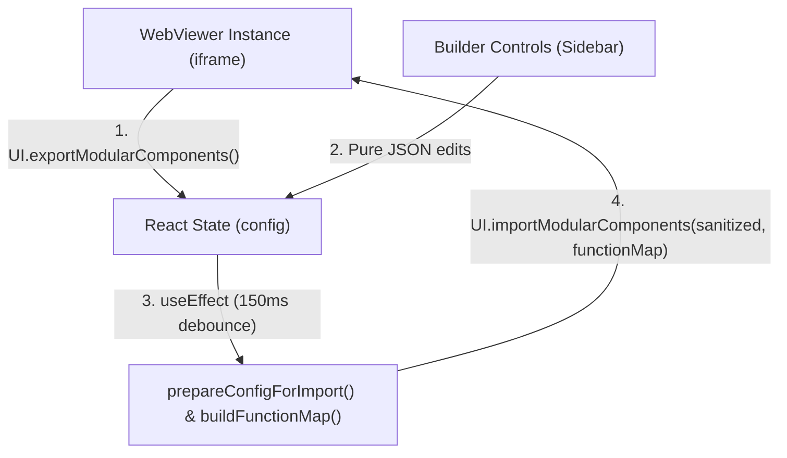

# WebViewer UI Builder (`webviewer-ui-builder`)

An interactive visual UI designer and configuration tool for building custom [Apryse WebViewer](https://apryse.com/docs/core/overview) (v11.8+) Modular UI templates.

---

## Architecture & Synchronization Lifecycle

The builder does not manipulate the WebViewer iframe DOM directly or call granular imperative SDK methods (such as `setHeaderItems` or `addCustomButton`). Instead, it is powered entirely by WebViewer's **Declarative Modular UI Engine**:



### How the Lifecycle Works

1. **Snapshot on Initial Mount (`exportModularComponents`)**:
   When the builder mounts in `ModularUIBuilder.jsx`, it calls `window.viewerInstance.UI.exportModularComponents()`. This exports WebViewer's default UI configuration as a JSON tree into React state (`config`), establishing the baseline headers, tool buttons, flyouts, and panels.

2. **Reactive State Manipulation**:
   All user actions in the builder (adding buttons, reordering headers, modifying tabs, binding flyouts) are pure JSON transformations on the `config` state object.

3. **Debounced Auto-Apply (`useEffect`)**:
   Re-importing the UI into WebViewer tears down and rebuilds header and ribbon component trees. To keep interactions smooth:
   - An `isInitialMount` ref guard ensures the app does not immediately re-import the configuration it just extracted.
   - A `useEffect` watching `[config, autoApply]` debounces changes by `150ms` (`setTimeout` / `clearTimeout`). Rapid operations (such as typing labels or dragging items) batch together, executing only when the user pauses.

4. **Sanitization & Guardrails (`prepareConfigForImport`)**:
   WebViewer validates Modular UI imports strictly and drops entire headers or flyouts if unsupported structures are encountered. Before any configuration is handed to WebViewer, `prepareConfigForImport`:
   - Enforces container placement limits (e.g. maximum of 2 top headers, 1 left/right header).
   - Converts illegal flyout items (such as `toolButton` in flyouts) into `customButton` items wired to tool activators.
   - Expands nested submenu `children` back into inline objects.
   - Cleans up orphaned or missing toggle targets.

5. **Function Map Generation (`buildFunctionMap`)**:
   Because JSON configs only store serializable strings, actions such as tool activations (`activateTool:<toolName>`), custom button `onClick` handlers, and custom element renderers are resolved dynamically into a live `functionMap` dictionary.

6. **Live Re-hydration (`importModularComponents`)**:
   The builder dispatches:
   ```javascript
   window.viewerInstance.UI.importModularComponents(sanitized, functionMap);
   ```
   WebViewer ingests the schema, updates its internal Redux store, re-renders the UI within the viewer iframe, and binds tool activation modes natively.

---

## Master Component Capability & Constraints Matrix

Apryse WebViewer's Modular UI enforces strict validation rules across its container hierarchy (`modularHeaders`, `modularComponents`, `flyouts`, `panels`, and `popups`). The table below outlines what each container natively accepts, what is rejected or causes runtime crashes in WebViewer, and the engineering workarounds implemented in this builder.

| Container / Parent                                               | Natively Allowed by WebViewer SDK                                                                                                                                                                            | Strictly Disallowed / SDK Rejections & Crashes                                                                                                                                                                                                                                                                                                                                                                                                                                   | Engineering Workarounds & Notes                                                                                                                                                                                                                                                                                         |
| :--------------------------------------------------------------- | :----------------------------------------------------------------------------------------------------------------------------------------------------------------------------------------------------------- | :------------------------------------------------------------------------------------------------------------------------------------------------------------------------------------------------------------------------------------------------------------------------------------------------------------------------------------------------------------------------------------------------------------------------------------------------------------------------------- | :---------------------------------------------------------------------------------------------------------------------------------------------------------------------------------------------------------------------------------------------------------------------------------------------------------------------- |
| **Modular Header**<br>`config.modularHeaders[id]`                | • `toolButton`<br>• `presetButton`<br>• `toggleButton`<br>• `customButton`<br>• `ribbonGroup`<br>• `groupedItems`<br>• `viewControls`, `pageControls`, `zoom`<br>• `divider`, `spacer`, `label`              | • Another `modularHeader` (headers cannot nest)<br>• `tabPanel` (sidebars belong in `config.panels`)<br>• Direct `children` drilldowns without a flyout container<br>• **>1 full-length header on `left` or `right`** (SDK drops 2nd header with `Left headers only support one full length header...`).<br>• **>2 full-length headers on `top`** (SDK only mounts first two).                                                                                                   | Headers are viewport edge bars (`top`, `bottom`, `left`, `right`). Supports `gap` (px) and `justifyContent`. When placing ribbons on `left` or `right`, use **Inline (1 Single Bar)** so tools render vertically on the same header without exceeding the 1-header SDK limit.                                           |
| **Flyout Menu**<br>`config.flyouts[id].items`                    | • `presetButton`<br>• `customButton`<br>• `statefulButton`<br>• `toggleButton` (cannot target another flyout)<br>• Literal string token `'divider'`<br>• **Submenu** (`customButton` with `children: [...]`) | • **`toolButton` IS STRICTLY REJECTED**: WebViewer's SDK validator throws `Invalid flyout found` and drops the flyout.<br>• **`toggleButton` targeting another flyout**: Clicking it crashes `Flyout.js` (TypeError / closes parent instead of nesting).<br>• Component object `{ type: 'divider' }` (crashes validator; only literal string `'divider'` allowed).<br>• `modularHeader`, `ribbonGroup`, `ribbonItem`, `tabPanel`, `viewControls`, `pageControls`, `popupAction`. | • **Tools in Flyouts**: Represented as a `customButton` with `onClick: activateTool:<toolName>` resolved via `functionMap` in `UI.importModularComponents(config, functionMap)`.<br>• **Multi-Level Menus**: Use drill-down **Submenus** (`children`), which Apryse built specifically for nested in-flyout navigation. |
| **Submenu**<br>`type: 'customButton'` with `children`            | • `presetButton`<br>• `customButton`<br>• Nested `customButton` with `children` (multi-level drill-down)<br>• `statefulButton`<br>• `toggleButton`<br>• Literal string token `'divider'`                     | • **`toolButton` IS STRICTLY REJECTED**: Same validator restriction as flyouts.<br>• `toggleButton` targeting an external flyout.<br>• Structural containers (`modularHeader`, `ribbonGroup`, `tabPanel`).                                                                                                                                                                                                                                                                       | • **Tools in Submenus**: Handled via `customButton` tool actions wired through `functionMap`.<br>• Clicking a submenu swaps the flyout viewport to the child list with an automatic "Back" button at the top.                                                                                                           |
| **RibbonGroup**<br>`type: 'ribbonGroup'`                         | • `ribbonItem` only (interactive tabs: View, Annotate, Shapes, etc.)                                                                                                                                         | • Loose buttons, tools, or preset buttons directly without a `ribbonItem`.                                                                                                                                                                                                                                                                                                                                                                                                       | Acts purely as a **tab switcher controller** (dispatches active tab state). Does **not** render tool buttons inside itself. Its tool containers (`groupedItems`) must be mounted in a `modularHeader`'s `items`.                                                                                                        |
| **RibbonItem (Tab)**<br>`type: 'ribbonItem'`                     | • `groupedItems: ["<key>", ...]` (references to container keys)                                                                                                                                              | • Direct buttons without a `groupedItems` container.                                                                                                                                                                                                                                                                                                                                                                                                                             | Defines which tool group (`groupedItems`) should be activated when this tab is selected.                                                                                                                                                                                                                                |
| **GroupedItems**<br>`type: 'groupedItems'`                       | • `toolButton`<br>• `presetButton`<br>• `toggleButton`<br>• `customButton`<br>• `viewControls`, `pageControls`<br>• Literal string token `'divider'`                                                         | • `modularHeader`, `ribbonGroup`, `ribbonItem`, `tabPanel`<br>• Component object `{ type: 'divider' }` (must use string token `'divider'`)                                                                                                                                                                                                                                                                                                                                       | Represents a cluster of tools on a ribbon tab. Supports `gap` (default `12`) and `grow`.                                                                                                                                                                                                                                |
| **Tab Panel**<br>`config.panels[id]`, `render: 'tabPanel'`       | • Sub-panel renders in `panelsList: [{ render: '<panelName>' }]` where `<panelName>` is a whitelisted render (`thumbnailsPanel`, `outlinesPanel`, `bookmarksPanel`, etc.)                                    | • Any button, tool, flyout, or header.<br>• Missing/empty `panelsList` (crashes WebViewer render).<br>• Non-whitelisted panel render without a custom function in `functionMap`.                                                                                                                                                                                                                                                                                                 | Dockable sidebar docking multiple panel icons. Toggled using a `toggleButton` (`toggleElement: '<panelId>'`).                                                                                                                                                                                                           |
| **Popups**<br>`annotationPopup`, `textPopup`, `contextMenuPopup` | • `presetButton`<br>• `customButton`<br>• `toolButton`<br>• `toggleButton`<br>• `popupAction` (copy, delete, style, note, etc.)                                                                              | • `modularHeader`, `ribbonGroup`, `tabPanel`.<br>• Controls (`viewControls`, `pageControls`).<br>• Dividers (`divider`).<br>• Submenus with `children` (drill-downs are not supported in transient floating popups).                                                                                                                                                                                                                                                             | Popup items are declared self-contained inline inside `config.popups[popupKey]` rather than referencing keys in `modularComponents`.                                                                                                                                                                                    |

---

## Key Modular UI Concepts

### 1. Standalone Flyouts vs Toggle Buttons

In WebViewer, dropdown menus are defined as independent overlay containers under `config.flyouts`. Any `toggleButton` can trigger an element by setting its `toggleElement` attribute to the target's ID. You can create standalone flyouts and wire toggle buttons to them from headers, ribbons, or popups.

### 2. Multi-Level Flyout Submenus

Because placing a flyout toggle button inside another flyout causes WebViewer's `Flyout.js` to crash, multi-level menus are implemented via **Submenus**:

```json
{
  "type": "customButton",
  "dataElement": "moreToolsSubmenu",
  "label": "More Tools",
  "img": "icon-header-chevron-right",
  "children": [
    {
      "type": "customButton",
      "dataElement": "drawingSubmenu",
      "label": "Drawing Tools",
      "children": [ ... ]
    }
  ]
}
```

WebViewer automatically renders drill-down navigation with a top "Back" button at each nesting depth.

### 3. Activating Tools from Flyouts (`functionMap`)

WebViewer rejects `{ type: "toolButton" }` inside flyouts and submenus. To activate tools from within a flyout, use a `customButton` and supply a `functionMap` to `UI.importModularComponents(config, functionMap)`:

```javascript
const functionMap = {
  'activateTool:Pan': () => {
    instance.Core.documentViewer.setToolMode(
      instance.Core.documentViewer.getTool('Pan'),
    );
  },
};

instance.UI.importModularComponents(config, functionMap);
```

### 4. Ribbon Tabs vs. Tool Rendering (Controller vs. View Architecture)

A common point of confusion is why a `modularHeader` must explicitly declare each tab's `groupedItems` in its `items` array even when `ribbonGroup` already references them via `groupedItems: [...]`.

In WebViewer Modular UI:

- **`RibbonGroup` and `RibbonItem` are state controllers, not layout containers for the tools:**
  A `ribbonGroup` only renders the interactive tab buttons (e.g. `[Annotate] [Shapes]`). Clicking a tab simply dispatches an internal state change (`setActiveGroupedItems(['annotateGroupedItems'])`). It does **not** physically mount or render tool buttons inside itself.
- **`modularHeader` is the DOM mount container:**
  WebViewer's header engine iterates through `header.items`. For each item of type `groupedItems`, it only renders the component into the DOM if its ID matches the currently active ribbon tab (otherwise auto-collapsing it). If the `groupedItems` key is missing from the header's `items`, WebViewer never mounts the tool buttons anywhere.

#### Layout Options:

1. **Inline (Single Header Bar):**
   Place both the `ribbonGroup` and each tab's `groupedItems` in the **same header**:

   ```json
   "bottom-header": {
     "placement": "bottom",
     "items": ["main-ribbon-group", "divider", "annotateGroupedItems", "shapesGroupedItems"]
   }
   ```

   Tabs and active tool buttons render side-by-side on a single header bar (top or bottom). No second header is needed.

2. **Stacked / Multi-Row (Separate Headers):**
   Place `ribbonGroup` in one header (e.g., `default-top-header` or `bottom-tabs-header`) and the `groupedItems` in a companion header (e.g., `tools-header`):
   ```json
   "header-tabs": { "placement": "bottom", "items": ["main-ribbon-group"] },
   "tools-header": { "placement": "bottom", "items": ["annotateGroupedItems", "shapesGroupedItems"] }
   ```
   Creates the traditional Microsoft Office 2-row ribbon layout.

#### Edge Header Limits (SDK Architectural Constraint)

- **Top:** Maximum of **2** full-length headers (`default-top-header` + `tools-header`). Any additional top header is dropped.
- **Bottom:** Supports multiple stacked headers.
- **Left & Right:** Maximum of **1** full-length header. The SDK explicitly drops any 2nd full-length vertical header (`Left headers only support one full length header but 2 were added. Only the first one will be rendered.`).
- **Workaround for Left/Right Ribbons:** Always use **Inline (1 Single Bar)** layout for `left` or `right` headers so both the tab buttons and active tools reside in that single vertical strip. Alternatively, place the ribbon tabs on the `left` and the companion `tools-header` on `top` or `bottom`.

---

## Quick Start

1. **Install dependencies**:

   ```bash
   npm install
   ```

   The `postinstall` script copies WebViewer static assets into `public/lib/webviewer`.

2. **Run the development server**:

   ```bash
   npm run dev
   ```

3. **Build for production**:
   ```bash
   npm run build
   ```

---

## License

This project is licensed under the MIT License — see the `LICENSE` file for details.
