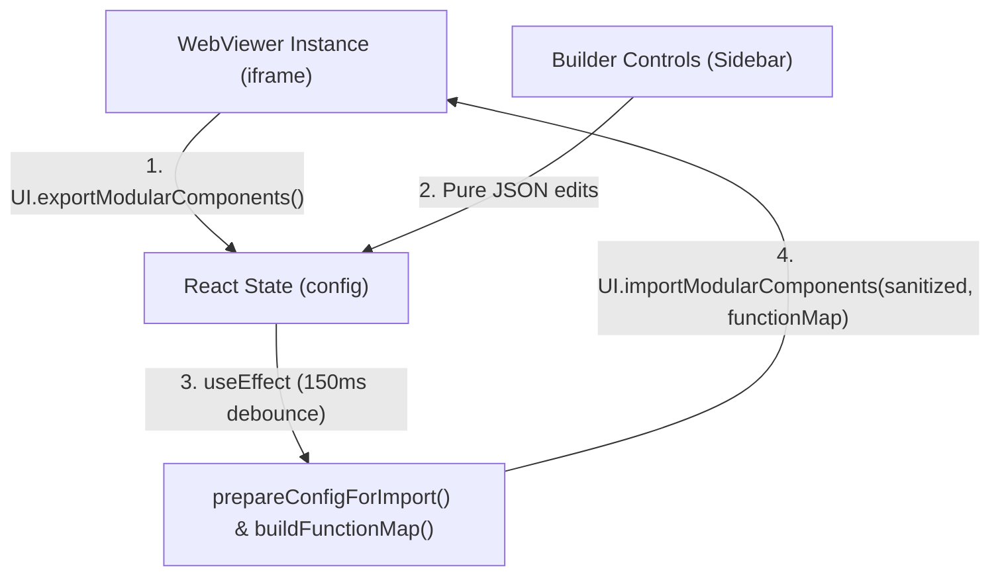

# WebViewer UI Builder (`webviewer-ui-builder`)

An interactive visual UI designer and configuration tool for building custom [Apryse WebViewer](https://apryse.com/docs/core/overview) (v11.8+) Modular UI templates.

---

## Architecture & Synchronization Lifecycle

The builder does not manipulate the WebViewer iframe DOM directly or call granular imperative SDK methods (such as `setHeaderItems` or `addCustomButton`). Instead, it is powered entirely by WebViewer's **Declarative Modular UI Engine**:



### How the Lifecycle Works

1. **Snapshot on Initial Mount (`exportModularComponents`)**:
   When the builder mounts in `ModularUIBuilder.jsx`, it calls `window.viewerInstance.UI.exportModularComponents()`. This exports WebViewer's default UI configuration as a JSON tree into React state (`config`), establishing the baseline headers, tool buttons, flyouts, and panels.

2. **Reactive State Manipulation**:
   All user actions in the builder (adding buttons, reordering headers, modifying tabs, binding flyouts) are pure JSON transformations on the `config` state object.

3. **Debounced Auto-Apply (`useEffect`)**:
   Re-importing the UI into WebViewer re-renders header and ribbon component trees. To keep interactions smooth:
   - An `isInitialMount` ref guard ensures the app does not immediately re-import the configuration it just extracted.
   - A `useEffect` watching `[config, autoApply]` debounces changes by `150ms` (`setTimeout` / `clearTimeout`). Rapid operations (such as typing labels or dragging items) batch together, executing only when the user pauses.

4. **Schema Normalization & Validation (`prepareConfigForImport`)**:
   WebViewer validates Modular UI configurations against strict schema definitions. Before importing into WebViewer, `prepareConfigForImport`:
   - Validates container placements and limits against viewport edge specifications.
   - Normalizes flyout action items and wires tool activation actions to declarative handlers.
   - Recursively expands nested submenu `children` into complete declarative definitions.
   - Cleans up unassigned or missing toggle targets.

5. **Function Map Generation (`buildFunctionMap`)**:
   Because JSON configurations represent serializable data, interactive actions such as tool activations (`activateTool:<toolName>`), custom button `onClick` handlers, and custom element renderers are dynamically resolved into a companion `functionMap` dictionary.

6. **Live Re-hydration (`importModularComponents`)**:
   The builder dispatches:
   ```javascript
   window.viewerInstance.UI.importModularComponents(sanitized, functionMap);
   ```
   WebViewer ingests the schema, updates its internal store, re-renders the UI within the viewer iframe, and binds tool activation modes natively.

---

## Modular UI Component Architecture & Hierarchy

Apryse WebViewer's Modular UI defines a structured hierarchy across its container models (`modularHeaders`, `modularComponents`, `flyouts`, `panels`, and `popups`). The table below outlines supported elements, structural constraints, and recommended layout patterns.

| Container / Parent                                               | Supported Children & Elements                                                                                                                                                                   | Structural Constraints                                                                                                                                                                                                                          | Recommended Design Patterns & Notes                                                                                                                                                          |
| :--------------------------------------------------------------- | :---------------------------------------------------------------------------------------------------------------------------------------------------------------------------------------------- | :---------------------------------------------------------------------------------------------------------------------------------------------------------------------------------------------------------------------------------------------- | :------------------------------------------------------------------------------------------------------------------------------------------------------------------------------------------- |
| **Modular Header**<br>`config.modularHeaders[id]`                | • `toolButton`<br>• `presetButton`<br>• `toggleButton`<br>• `customButton`<br>• `ribbonGroup`<br>• `groupedItems`<br>• `viewControls`, `pageControls`, `zoom`<br>• `divider`, `spacer`, `label` | • Top-level edge container only (`top`, `bottom`, `left`, `right`)<br>• Cannot nest inside other headers<br>• Sidebars belong in `config.panels`<br>• Up to 2 full-length headers on `top`<br>• Up to 1 full-length header on `left` or `right` | Supports `gap` (px) and `justifyContent`. For vertical ribbons on `left` or `right`, use **Inline (Single Header Bar)** layout so tabs and tool groups render within the single bar.         |
| **Flyout Menu**<br>`config.flyouts[id].items`                    | • `presetButton`<br>• `customButton`<br>• `statefulButton`<br>• `toggleButton`<br>• Literal string token `'divider'`<br>• **Submenu** (`customButton` with `children: [...]`)                   | • Dropdown/flyout container for menus<br>• Structural containers (`modularHeader`, `ribbonGroup`, `tabPanel`) belong at top level<br>• Dividers must use the string token `'divider'`                                                           | • **Multi-Level Menus**: Use drill-down **Submenus** (`children`), the native pattern for in-flyout navigation.<br>• **Tool Activation**: Wire actions via `customButton` and `functionMap`. |
| **Submenu**<br>`type: 'customButton'` with `children`            | • `presetButton`<br>• `customButton`<br>• Nested `customButton` with `children`<br>• `statefulButton`<br>• `toggleButton`<br>• Literal string token `'divider'`                                 | • Child list within a flyout menu<br>• Structural containers belong at top level                                                                                                                                                                | Clicking a submenu smoothly navigates to the child list with an automatic "Back" button at the top.                                                                                          |
| **RibbonGroup**<br>`type: 'ribbonGroup'`                         | • `ribbonItem` only (interactive tabs: View, Annotate, Shapes, etc.)                                                                                                                            | • Dedicated tab-controller component<br>• Tool clusters are defined in companion `groupedItems`                                                                                                                                                 | Acts as a **tab switcher controller** (dispatches active tab state). Tool containers (`groupedItems`) are mounted in the header's `items`.                                                   |
| **RibbonItem (Tab)**<br>`type: 'ribbonItem'`                     | • `groupedItems: ["<key>", ...]` (references to tool container keys)                                                                                                                            | • Must reference existing `groupedItems` keys                                                                                                                                                                                                   | Defines which tool group (`groupedItems`) activates when this tab is selected.                                                                                                               |
| **GroupedItems**<br>`type: 'groupedItems'`                       | • `toolButton`<br>• `presetButton`<br>• `toggleButton`<br>• `customButton`<br>• `viewControls`, `pageControls`<br>• Literal string token `'divider'`                                            | • Cluster container for tools on a ribbon tab<br>• Dividers use string token `'divider'`                                                                                                                                                        | Represents a cluster of tools on a ribbon tab. Supports `gap` (default `12`) and `grow`.                                                                                                     |
| **Tab Panel**<br>`config.panels[id]`, `render: 'tabPanel'`       | • Sub-panel renders in `panelsList: [{ render: '<panelName>' }]` (`thumbnailsPanel`, `outlinesPanel`, `bookmarksPanel`, etc.)                                                                   | • Sidebar panel container<br>• Requires valid `panelsList` array                                                                                                                                                                                | Dockable sidebar docking multiple panel icons. Toggled via a `toggleButton` (`toggleElement: '<panelId>'`).                                                                                  |
| **Popups**<br>`annotationPopup`, `textPopup`, `contextMenuPopup` | • `presetButton`<br>• `customButton`<br>• `toolButton`<br>• `toggleButton`<br>• `popupAction` (copy, delete, style, note, etc.)                                                                 | • Transient contextual floating popups                                                                                                                                                                                                          | Popups are declared self-contained inline inside `config.popups[popupKey]`.                                                                                                                  |

---

## Key Modular UI Concepts

### 1. Standalone Flyouts & Toggle Buttons

In WebViewer, dropdown menus are defined as independent overlay containers under `config.flyouts`. Any `toggleButton` can trigger an element by setting its `toggleElement` attribute to the target's ID. You can create standalone flyouts and wire toggle buttons to them from headers, ribbons, or popups.

### 2. Multi-Level Flyout Submenus

Hierarchical multi-level menus are implemented via **Submenus** using the `children` array on a `customButton`:

```json
{
  "type": "customButton",
  "dataElement": "moreToolsSubmenu",
  "label": "More Tools",
  "img": "icon-header-chevron-right",
  "children": [
    {
      "type": "customButton",
      "dataElement": "drawingSubmenu",
      "label": "Drawing Tools",
      "children": [ ... ]
    }
  ]
}
```

WebViewer automatically renders drill-down navigation with a top "Back" button at each nesting depth.

### 3. Tool Activation from Flyouts (`functionMap`)

To activate tools from within a flyout or submenu, configure a `customButton` and register the tool activation handler in `functionMap` passed to `UI.importModularComponents(config, functionMap)`:

```javascript
const functionMap = {
  'activateTool:Pan': () => {
    instance.Core.documentViewer.setToolMode(
      instance.Core.documentViewer.getTool('Pan'),
    );
  },
};

instance.UI.importModularComponents(config, functionMap);
```

### 4. Ribbon Tabs vs. Tool Rendering (Controller vs. View Architecture)

In WebViewer Modular UI, ribbon tabs and tool groups follow a clean controller/view separation:

- **`RibbonGroup` and `RibbonItem` are state controllers:**
  A `ribbonGroup` renders interactive tab buttons (e.g. `[Annotate] [Shapes]`). Selecting a tab dispatches an active state event (`setActiveGroupedItems(['annotateGroupedItems'])`).
- **`modularHeader` is the DOM mount container:**
  WebViewer's header engine iterates through `header.items`. For each item of type `groupedItems`, it renders the component into the DOM when its ID matches the currently active ribbon tab.

#### Supported Layout Patterns:

1. **Inline (Single Header Bar):**
   Place both the `ribbonGroup` and each tab's `groupedItems` in the **same header**:

   ```json
   "bottom-header": {
     "placement": "bottom",
     "items": ["main-ribbon-group", "divider", "annotateGroupedItems", "shapesGroupedItems"]
   }
   ```

   Tabs and active tool buttons render side-by-side on a single header bar (top or bottom).

2. **Stacked / Multi-Row (Separate Headers):**
   Place `ribbonGroup` in one header and `groupedItems` in a companion header:
   ```json
   "header-tabs": { "placement": "top", "items": ["main-ribbon-group"] },
   "tools-header": { "placement": "top", "items": ["annotateGroupedItems", "shapesGroupedItems"] }
   ```
   Creates the traditional multi-row ribbon layout.

#### Viewport Placement Guidelines:

- **Top:** Supports up to 2 full-length headers (ideal for stacked tab + tool bars).
- **Bottom:** Supports multiple stacked headers.
- **Left & Right:** Supports 1 full-length header. For vertical side layouts, use **Inline (Single Header Bar)** so both tab selectors and active tool groups share the vertical strip.

---

## Quick Start

1. **Install dependencies**:

   ```bash
   npm install
   ```

   The `postinstall` script copies WebViewer static assets into `public/lib/webviewer`.

2. **Run the development server**:

   ```bash
   npm run dev
   ```

3. **Build for production**:
   ```bash
   npm run build
   ```

---

## License

This project is licensed under the MIT License — see the `LICENSE` file for details.
